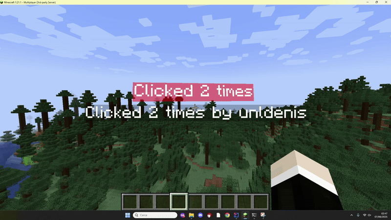
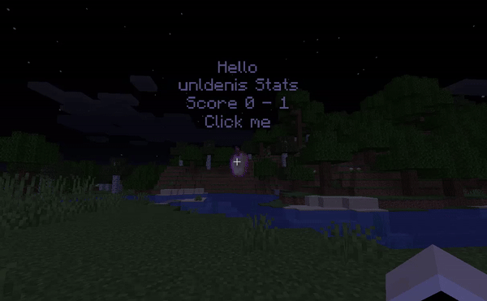

# HoloEasy

[](https://jitpack.io/#denmeh/holoeasy)

HoloEasy is a simple, modern, high-performance Java and Kotlin Minecraft hologram library for Spigot / Paper servers (1.8 through current releases, including Display entities on 1.19.4+).

## Documentation

Full guide (install, first hologram, lines, pools, clicks):

**https://denmeh.github.io/holoeasy/**

## Quick install

JitPack + CodeMC repositories, then:

```groovy
dependencies {
    compileOnly 'com.github.denmeh.holoeasy:holoeasy-core:5.0.0'
    compileOnly 'com.github.retrooper:packetevents-spigot:2.14.0'
}
```

HoloEasy does not bundle PacketEvents — you must load and init it in your plugin. See the docs for the full lifecycle.

## Build the example plugins

```bash
just example          # Java → holoeasy-example-java/build/libs/*-shadow.jar
just example-kotlin   # Kotlin equivalent
```

## Preview

Display-entity counter example (`holoeasy-example-java`):



---



---


## Stargazers over time

[](https://starchart.cc/denmeh/holoeasy)
